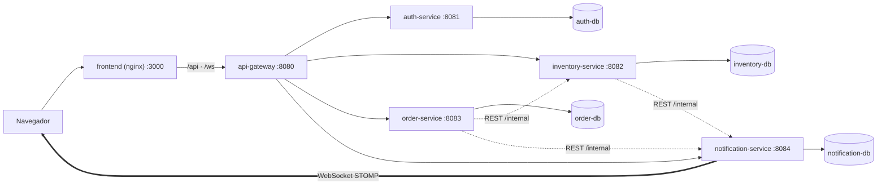

# Sistema de Inventario y Pedidos — Arquitectura de Microservicios

> **EN —** Full-stack inventory & order management platform built as microservices: Java 17 / Spring Boot services (auth, inventory, orders, notifications) behind a Spring Cloud Gateway with JWT, a React + TypeScript + Tailwind frontend, real-time notifications over WebSocket (STOMP), one PostgreSQL database per service, all orchestrated with Docker Compose. UI in Spanish, code in English.
>
> **Status: preliminary snapshot (pre-review).** The whole stack runs and passes an end-to-end smoke test, but an independent security / UX / correctness review is still being applied. See [Estado del proyecto](#estado-del-proyecto).

Plataforma full-stack de gestión de inventario y pedidos basada en microservicios (Java 17, Spring Boot). Servicios independientes de autenticación, inventario, pedidos y notificaciones, comunicados mediante un API Gateway (Spring Cloud Gateway) con autenticación JWT. Frontend en React, TypeScript y Tailwind CSS. Comunicación REST entre servicios, notificaciones en tiempo real (WebSocket), PostgreSQL por servicio y contenedores Docker / Docker Compose para orquestar el entorno.

## Arquitectura



| Servicio | Puerto interno | Responsabilidad |
|---|---|---|
| `frontend` | 3000 (host) | React + TS + Tailwind servido por nginx; proxy de `/api` y `/ws` al gateway |
| `api-gateway` | 8080 (host) | Spring Cloud Gateway: valida JWT, enruta, bloquea `/internal/**` |
| `auth-service` | 8081 | Registro, login y emisión de JWT (HS256, BCrypt) |
| `inventory-service` | 8082 | Productos, ajustes de stock, reserva/liberación de stock idempotente |
| `order-service` | 8083 | Pedidos y máquina de estados; reserva stock vía REST |
| `notification-service` | 8084 | Historial de notificaciones y WebSocket STOMP en tiempo real |

Solo `frontend` (3000) y `api-gateway` (8080) publican puertos, y únicamente en `127.0.0.1`. Cada servicio con datos tiene su propio PostgreSQL 16 (migraciones con Flyway). El contrato técnico completo (rutas, tipos, códigos de error, JWT, WebSocket, variables de entorno) está en [`docs/CONTRACT.md`](docs/CONTRACT.md).

## Funcionalidades

- Registro e inicio de sesión con JWT; todo usuario autenticado puede operar (un solo rol, pensado como herramienta interna).
- Productos: alta, edición, baja lógica, búsqueda, filtro de stock bajo y ajustes de stock con motivo.
- Pedidos: creación con reserva de stock **todo-o-nada**, estados `PENDING → CONFIRMED → SHIPPED → DELIVERED` o `CANCELLED` (cancelar libera el stock). El precio siempre lo fija inventario, nunca el cliente.
- Notificaciones en tiempo real: nuevo pedido, stock bajo y cambio de estado del pedido, con historial y marcado de leídas.
- Interfaz en español, modo claro/oscuro y diseño responsive.

## Puesta en marcha

Requisitos: Docker Desktop (Docker Compose v2). No hace falta JDK, Maven ni Node: todo se compila dentro de Docker.

```bash
# 1) Generar .env con secretos aleatorios (no se versiona; no imprime los secretos)
#    Windows (PowerShell):
./scripts/init-env.ps1
#    Git Bash / Linux / macOS:
bash scripts/init-env.sh

# 2) Construir y levantar todo (la primera vez descarga dependencias de Maven y tarda varios minutos)
docker compose up -d --build

# 3) Abrir la aplicación
#    http://localhost:3000   → regístrate y empieza
```

Parar: `docker compose down` (añade `-v` para borrar también los datos).

> **Puertos:** por defecto se usan 3000 (web) y 8080 (API), solo en `127.0.0.1`. Si alguno está ocupado (por ejemplo por un servidor de desarrollo de Next.js o Vite), cambia `FRONTEND_PORT` / `GATEWAY_PORT` en tu `.env` y añade el nuevo origen a `ALLOWED_ORIGINS`. Ojo: si otra aplicación escucha en 3000 por IPv6, `http://localhost:3000` puede mostrar *esa* aplicación; prueba con `http://127.0.0.1:3000` o cambia el puerto.

## Pruebas

```bash
# Tests de los servicios Java dentro de Docker (todos, o indica uno)
./scripts/test-java.ps1            # PowerShell      (o: bash scripts/test-java.sh)
./scripts/test-java.ps1 order-service

# Tests del frontend
cd frontend && npm ci && npm run typecheck && npm run lint && npm test

# Prueba de humo del conjunto (requiere el stack levantado; BASE_URL opcional)
node scripts/smoke-test.mjs                          # contra el gateway (8080)
BASE_URL=http://localhost:3000 node scripts/smoke-test.mjs   # a través de nginx
```

La prueba de humo recorre registro/login, productos, pedidos con consistencia de stock, 12 pedidos simultáneos por 5 unidades (no hay sobreventa), notificaciones en tiempo real por WebSocket y los controles de seguridad del gateway.

## Seguridad (resumen)

- JWT HS256 validado en el gateway **y** revalidado en cada servicio (defensa en profundidad).
- Rutas `/internal/**` solo con `X-Internal-Key` (comparación en tiempo constante); el gateway nunca las enruta ni deja pasar cabeceras internas desde fuera.
- WebSocket: autenticación en el frame STOMP `CONNECT`, lista blanca de `Origin`, destinos restringidos.
- Sin secretos en el repositorio: se generan en `.env` (ignorado por git). Los servicios no arrancan sin secretos válidos.
- Contenedores sin root, puertos publicados solo en loopback, CSP estricta en nginx.

## Limitaciones conocidas (fuera del MVP)

Sin refresh tokens, recuperación de contraseña, roles finos, rate limiting, broker de mensajes ni saga/outbox (la cancelación de pedidos no es transaccional entre servicios), service discovery, observabilidad, HTTPS ni CI/CD. El registro es abierto (`REGISTRATION_ENABLED=false` lo cierra). El JWT no se revalida mientras un WebSocket sigue abierto.

## Estado del proyecto

**Versión preliminar: funciona de extremo a extremo, con correcciones de revisión todavía en curso.**

- **Verificado ejecutando:** el stack completo (4 PostgreSQL 16 reales + 5 servicios + nginx) levanta sano en Docker y la prueba de humo de 58 comprobaciones pasa tanto contra el gateway como a través de nginx. Los tests de order-service (375), inventory-service (194) y auth-service (81) se repitieron en Docker durante la integración. Cada servicio trae su propia suite (JUnit con H2 en modo PostgreSQL + Flyway; Vitest en el frontend).
- **Revisión independiente:** una revisión de seguridad, UX/accesibilidad y corrección encontró defectos reales, sobre todo condiciones de carrera en la reserva/cancelación de stock. Ya están corregidos e integrados order-service, inventory-service y auth-service; **faltan** api-gateway, notification-service y frontend.
- **Continuar con una IA:** prompt listo para pegar y pasos de prueba manual en [`docs/PROMPT-CONTINUAR.md`](docs/PROMPT-CONTINUAR.md).
- **Pendientes y siguiente paso:** lista priorizada con archivo y causa en [`docs/NEXT-STEPS.md`](docs/NEXT-STEPS.md).
- **No verificado todavía:** uso manual en navegadores y dispositivos reales, lectores de pantalla, rendimiento/carga, y la ejecución repetida de las suites de gateway, notificaciones y frontend tras sus correcciones.

Plan, decisiones y reparto del trabajo: [`PLAN.md`](PLAN.md).

## Estructura

```
services/        auth-service · api-gateway · inventory-service · order-service · notification-service
frontend/        React + TypeScript + Tailwind + Vite (+ Dockerfile y nginx.conf)
docs/CONTRACT.md Contrato técnico compartido por todos los servicios
scripts/         init-env, test-java, smoke-test
docker-compose.yml · .env.example
```

## Licencia

[MIT](LICENSE) © 2026 Arnie Adriano
